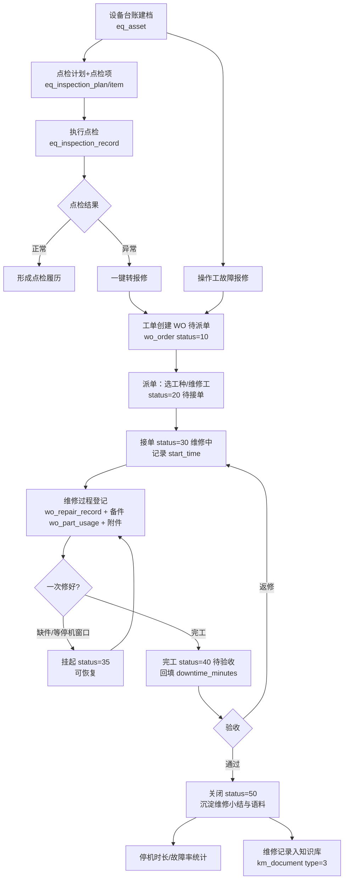
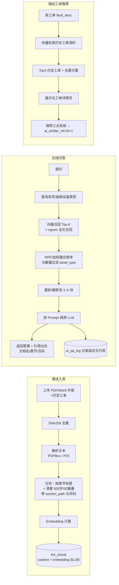

# 设备维保工单系统 + 维修知识 RAG 助手 · 设计与边界说明

> 定位：个人练习项目（虚拟产线数据，非公司系统）。
> 目标：一条业务主线 + 一个真实 RAG 场景，用最小范围证明"制造业务系统开发 + 大模型工程化落地"两件事。

---

## 一、主链路（业务闭环）



工单状态机（代码里用枚举 + 事件表双重约束，非法跃迁直接抛异常）：

| 当前状态 | 允许动作 | 目标状态 | 记录时间字段 |
|---|---|---|---|
| 10 待派单 | DISPATCH 派单 | 20 待接单 | dispatch_time |
| 10 | CANCEL 取消 | 70 已取消 | — |
| 10 | REJECT 驳回 | 60 已驳回 | — |
| 20 待接单 | ACCEPT 接单 | 30 维修中 | accept_time, start_time |
| 20 | REASSIGN 改派 | 20 | — |
| 30 维修中 | SUSPEND 挂起 | 35 挂起 | — |
| 35 挂起 | RESUME 恢复 | 30 | — |
| 30 | FINISH 完工 | 40 待验收 | finish_time, downtime_minutes |
| 40 待验收 | ACCEPT 验收通过 | 50 已关闭 | accept_result=1 |
| 40 | REJECT 验收返修 | 30 | accept_result=2 |

设计要点（面试可讲）：状态只允许通过 `transition(action)` 迁移，每次迁移写 `wo_order_event`，同时用 `version` 乐观锁防止两人抢同一张工单。

---

## 二、RAG 链路（AI 侧）



工程取舍（要能自圆其说）：

- **向量存储**：MVP 用 MySQL BLOB + JVM 内存暴力余弦（几千块 <20ms），避免第二套存储拉长工期；抽象 `EmbeddingStore` 接口，后续换 pgvector / Milvus 只改实现。
- **混合检索**：向量单路召回对"型号、代码、报错码"这类精确词很弱，所以必须加 `ngram` 全文一路做关键词兜底，两路融合。
- **可溯源**：每块都带 `section_path` 和 `page_no`，答案必须带引用，否则面试官会问"幻觉怎么办"。
- **可评估**：`ai_similar_ref.hit` 记录人工采纳率，能给出"相似工单 Top3 命中率 xx%"这种数字。

---

## 三、模块边界清单（做 / 不做，写死的红线）

### 做（P0，第一周必须跑通）

| 模块 | 内容 | 验收标准 |
|---|---|---|
| 设备台账 | 增删改查 + 关键度 + 运行状态 | 能按车间/类型筛选，3 台虚拟设备可维护 |
| 点检 | 计划、检查项、执行记录、异常一键转工单 | 一条点检异常能生成关联工单 |
| 工单 | 创建/派单/接单/开工/挂起/完工/验收/关闭 + 状态流水 | 全状态流转无非法跃迁，事件表完整可回溯 |
| 维修记录 | 多次维修、根因、处置措施、备件、附件 | 一个工单可挂多条维修记录 |
| 停机统计 | 按设备/车间统计停机时长与故障次数 | 一个接口出数，一个简单列表页 |
| 知识库 | 上传→解析→分块→入库→问答→引用 | 提问能答且带出处 |
| 相似工单 | 新工单详情页推荐 Top3 历史工单 | 点击可跳转历史工单 |
| 部署 | Docker Compose → K3s 清单 → Jenkins 流水线 | 提交到部署可现场演示 |

### 不做（刻意裁剪，面试主动说明）

- 多租户、RBAC 权限纵深、复杂审批流（只做单角色登录）
- 真实 PLC/MES/SCADA 对接与实时采集（只留 `source_type` 与采集接口占位）
- 移动端 App、完整报表体系、大屏
- 备件库存扣减与采购联动（只记录领用）
- 排产(APS)、视觉质检、数字孪生

一句话口径：**"我做的是 MES 设备模块里的一条最小闭环，不是 MES 复刻。"**

---

## 四、工程结构（单体后端 + 独立前端页面）

```
eqmaint/
├─ backend/                        Spring Boot 3.2 / JDK 21
│  ├─ src/main/java/com/eqmaint/
│  │  ├─ asset/        设备台账
│  │  ├─ inspection/   点检
│  │  ├─ workorder/    工单（含 statemachine/ 状态机、event 流水）
│  │  ├─ knowledge/    文档解析、分块、入库
│  │  ├─ rag/          EmbeddingStore、Retriever、PromptBuilder、LlmClient
│  │  ├─ stats/        停机统计
│  │  └─ common/       统一返回、异常、MyBatis-Plus 配置、Redis 缓存
│  └─ src/main/resources/
│     ├─ application.yml / application-docker.yml
│     └─ db/migration/V1__init.sql   （即 01-库表设计.sql）
├─ frontend/                        Vue3 + Element Plus（或纯 Thymeleaf，按你时间）
├─ deploy/
│  ├─ docker-compose.yml           mysql + redis + backend + frontend
│  ├─ k3s/                         deployment.yaml / service.yaml / ingress.yaml / configmap
│  └─ Jenkinsfile
├─ docs/
│  ├─ 01-库表设计.sql（本文件同级）
│  ├─ 02-设计与边界说明.md（本文件）
│  ├─ 03-接口清单.md
│  └─ 架构图.png
└─ README.md
```

技术栈定版（避免中途反复）：

- JDK 21 + Spring Boot 3.2 + MyBatis-Plus + MySQL 8 + Redis（问答缓存/幂等）
- Spring AI（或自写 LlmClient，二选一先自写，接口简单、不踩版本坑）
- 前端 Vue3 + Element Plus，只做 6 个页面
- Docker Compose → K3s；Jenkins 流水线做 CI/CD 演示

---

## 五、第一周执行清单（按天，可直接照做）

**第 1 天（今天）**
1. 建库跑 DDL：`mysql -u root -p < docs\01-库表设计.sql`
2. 建 Git 仓库骨架：`git init` + `mvn archetype` 或 start.spring.io 生成 Spring Boot 工程，先跑通 `/api/health`
3. 配置数据源，用 MyBatis-Plus 反向生成 14 张表的实体与 Mapper

**第 2 天**：设备台账 + 点检计划/项的 CRUD（先不做页面，用 Swagger/Postman 验证），这一天的产出就是"能造数据"

**第 3–4 天**：工单状态机（`WorkOrderStateMachine` + `transition()` + 事件落库 + 乐观锁），这是全项目最值得讲的代码，务必自己写不抄

**第 5 天**：维修记录、备件、附件上传（本地磁盘先够用）

**第 6 天**：停机统计接口 + 前端 6 个页面骨架（台账/点检/工单列表/工单详情/知识库/问答）

**第 7 天**：端到端跑一遍，录 30 秒演示视频；补 README 骨架

**第 8–10 天**：RAG（解析→分块→embedding→双路召回→引用），这是第二个核心产出

**第 11 天**：相似工单推荐 + 采纳反馈打点

**第 12–13 天**：Docker Compose → K3s → Jenkins，录"提交代码到自动部署"的演示

**第 14 天**：README、架构图、一页项目说明卡、简历条目

---

## 六、面试叙事（提前背熟）

1. **范围**：按制造业设备维保真实链路做了最小闭环，只做一条主线，其余刻意裁剪——体现范围控制。
2. **AI**：没做通用文档问答，而是把历史工单和维修 SOP 当语料，解决"老师傅经验留不住"这个具体痛点，并且答案强制带引用——体现业务洞察与工程严谨。
3. **工程**：工单状态机用事件表做审计 + 乐观锁防抢单；向量检索做了双路混合召回与人工采纳率评估；部署在 K3s，Jenkins 流水线可现场演示——体现不是本地玩具。
4. **诚实**：全程注明是个人练习项目、虚拟产线数据。

高频追问预判：
- "为什么不用 Milvus？" → 数据量几千块，引入独立存储是过度设计；接口已抽象，换实现成本低。
- "怎么防幻觉？" → 强制引用 + 检索分数阈值，低于阈值直接回"知识库无相关内容，建议转人工"。
- "工单并发怎么办？" → 乐观锁 version + 状态机前置校验，接单失败返回明确冲突提示。

---

## 七、风险与对策

| 风险 | 对策 |
|---|---|
| 范围膨胀（想加权限/报表） | 红线清单写死，第二周只做 RAG 与部署 |
| RAG 效果差、答不准 | 先做能跑通的最小版，用 3 个真实问题集（"主轴异响怎么办"等）做回归，再调分块与 Top-K |
| 前端拖工期 | 页面只做列表 + 表单 + 详情三态，样式不重要 |
| 部署卡住 | 先 Docker Compose 跑通，K3s 用单节点 + 本地镜像导入，不做镜像仓库 |
| 没有真实数据 | 自造 3 台虚拟设备 + 30 条历史工单语料，明确标注虚拟 |
