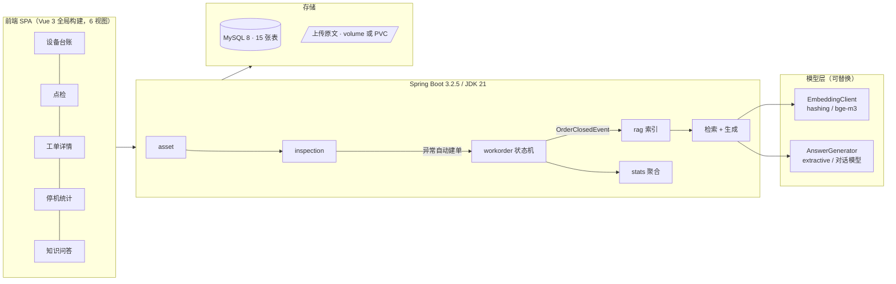
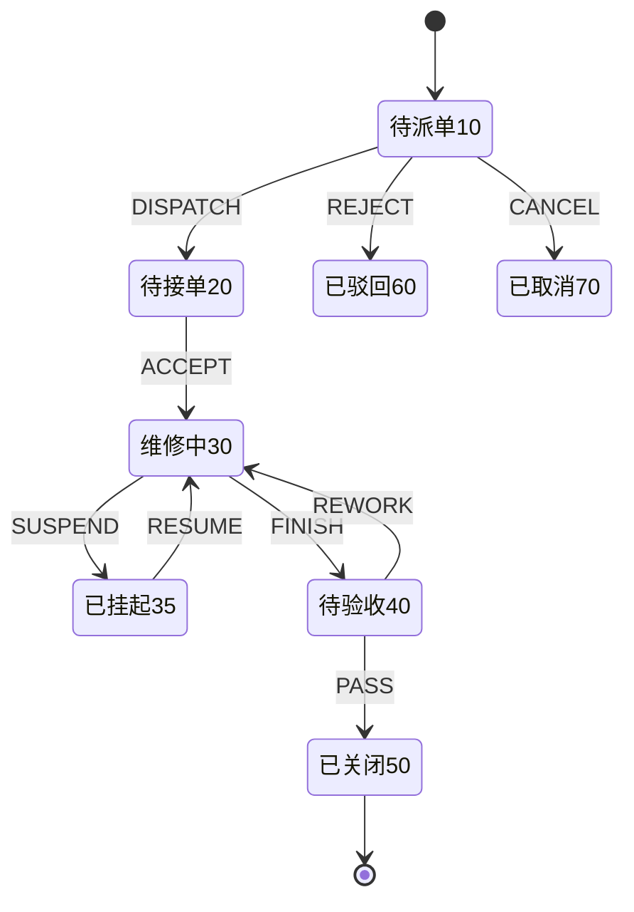

# 设备维保工单系统 + 维修知识 RAG 助手


把 MES 里**设备管理**这条链路（设备 → 点检 → 报修 → 工单 → 维修 → 停机统计 → 经验沉淀）做成一个能跑通、能部署、能演示的最小闭环，并在工单上叠了一层**维修知识 RAG**：手册里的处置步骤能被问答召回并给出处，历史工单能在新建工单时被推荐出来。

> **个人练习项目，全部数据为虚拟产线数据**，与任何真实工厂系统无关。刻意只做一条主线，其余范围明确舍弃（见[已知取舍](#已知取舍)）。

---

## 为什么是这个题目

制造业设备维保的真实痛点是三件事，而这个项目一件一件对着做：

| 现场痛点 | 这个项目里的对应实现 |
| --- | --- |
| 点检靠纸、异常靠打电话 | 点检计划 + 实测值超上下限自动判异常 → **同一事务内自动建工单**，设备状态联动为"维修中" |
| 工单状态靠人记、追责没依据 | 10 个状态的**状态机 + 事件流水 + 乐观锁**，每次迁移写 `wo_order_event`，非法跃迁后端返 400 |
| 停机时长、MTTR 没人算 | 五个统计维度（总览 / 设备 / 车间 / 故障分类 / 按天趋势）**三个维度交叉校验自洽** |
| **老师傅经验留不住** | 手册 + SOP + 历史工单入库，问答带章节页码出处；新建工单时推荐相似历史工单与处置方案 |

## 功能一览

| 模块 | 能力 | 状态 |
| --- | --- | --- |
| 设备台账 | 分页/多条件查询、新增、关键度分级、运行状态 | ✅ |
| 点检 | 计划（动态点检项）、执行（自动判异常）、异常一键转工单、记录分页 | ✅ |
| 工单 | 10 状态状态机、事件时间轴、维修记录、备件领用字段 | ✅ |
| 停机统计 | 总览 KPI + 按设备/车间/故障分类/趋势 | ✅ |
| 知识库 | PDF/DOCX/TXT 上传 → 解析 → 分块 → 向量入库 → 带引用问答 | ✅ |
| 相似工单 | 关单自动索引、向量召回 + 同类故障加成、采纳反馈 | ✅ |
| 大模型接入 | bge-m3（1024 维）+ 对话大模型，开关切换，失败自动降级 | ✅ |
| 部署 | Docker Compose、K3s 单节点（Ingress/PVC/滚动更新/回滚）、Jenkins 流水线 | ✅ |
| 前端 | 6 视图 SPA（Vue 3 全局构建，Spring Boot 静态托管，不引 npm） | ✅ |

## 架构



分层原则：`workorder` 不认识 `rag`。关单时发 `OrderClosedEvent`，`rag` 用 `@TransactionalEventListener(AFTER_COMMIT)` 订阅去建索引 —— 索引失败不影响关单，也避免 Service 互相依赖。

## 技术栈

| 层 | 选型 | 选择理由 |
| --- | --- | --- |
| 后端 | Spring Boot 3.2.5 / JDK 21 / MyBatis-Plus | 制造业后端主流组合；MyBatis-Plus 省掉单表 CRUD，复杂统计仍写 XML |
| 数据库 | MySQL 8 | 窗口函数 + ngram 全文索引够用；不引 ES，减少一个必装组件 |
| 向量 | 内存余弦（`VectorStore`）/ bge-m3 | 先跑对流程再换引擎；万级语料才需要 pgvector/Milvus |
| 生成 | 抽取式 / 对话大模型（OpenAI 兼容） | 无 key 也能演示，有 key 一行开关切换 |
| 前端 | Vue 3 全局构建 + 哈希路由 | 重点是后端与 RAG，前端够用即可，不引 npm 构建链 |
| 部署 | Docker Compose → K3s → Jenkins | 从"能跑"到"能编排"到"能自动化"，三层都有实跑记录 |

## 快速开始

只需要 Docker：

```bash
git clone <repo-url> && cd equipment-maintenance-rag
docker compose up -d --build      # 首次自动建库、建表、灌种子与 12 条演示工单
docker compose ps                  # eqmaint-app 与 eqmaint-mysql 都 healthy 即可
```

| 入口 | 地址 |
| --- | --- |
| 应用 | http://localhost:8080 |
| 健康检查 | http://localhost:8080/api/health |
| Swagger UI | http://localhost:8080/doc |
| 数据库 | 宿主机 `3307` → 容器 `3306`（刻意错开本机 3306） |

> 首次启动 MySQL 初始化约 5~7 分钟（InnoDB 初始化 + 执行三个建表/种子脚本），期间 `mysqladmin ping` 不通是正常冷启动。

不装 Docker 也可以直跑（需 JDK 21 + Maven + 本机 MySQL 8，库 `repair_order`）：

```bash
cd backend && mvn -DskipTests spring-boot:run
```

数据库连接可用环境变量覆盖：`DB_HOST / DB_PORT / DB_NAME / DB_USER / DB_PASSWORD`。

## 接大模型（可选，5 分钟）

默认是**本地替身**：字符 n-gram 哈希向量 + 抽取式作答，零依赖零费用，链路与出处都是真的。要换成真模型只改环境变量，代码不动：

```bash
export SF_API_KEY=sk-...                     # SiliconFlow，OpenAI 兼容
export RAG_EMBEDDING_PROVIDER=remote         # bge-m3，1024 维
export RAG_ANSWER_PROVIDER=remote            # Qwen2.5-7B-Instruct
export RAG_MIN_SCORE=0.55                    # 阈值必须跟着向量模型调
docker compose up -d app
curl -X POST http://localhost:8080/api/rag/reindex   # 换向量模型必须重建一次
```

同一份手册、同一句提问，两种实现的实测差距：

| 指标 | 本地哈希 + 抽取式 | bge-m3 + Qwen2.5-7B |
| --- | --- | --- |
| topScore | 0.546 | **0.818** |
| 作答形态 | 片段拼接 | 归纳成 5 条处置清单 |
| 引用 | 1 条 | 2 条（§1.1 主轴异响 0.818 / §1.2 油温过高 0.616） |
| 延迟 | 十几毫秒 | 4.6~6.5 秒 |
| 相似工单 | 0.346 / 0.153 / 0.141 | **0.627 / 0.585 / 0.566** |
| 库外问题 | 硬拼片段 | 明确回答"知识库中未找到相关内容，缺少清洗方法和步骤" |

**三条红线写在 system prompt 里，不是"建议"**：只能依据检索片段作答；每条结论用 `[n]` 标注来源且方括号里只放编号；片段不足就直说缺哪份手册哪一章，安全提示单独一行以"注意："开头。另有两个工程兜底：模型超时/报错**不抛 500**，自动退回抽取式并注明降级原因；只把答案里真正出现的 `[n]` 算作出处。

## 目录结构

```
equipment-maintenance-rag/
├─ backend/                        Spring Boot 后端
│  ├─ src/main/java/com/eqmaint/
│  │  ├─ asset/         设备台账
│  │  ├─ inspection/    点检（计划 / 点检项 / 记录 / 异常转单）
│  │  ├─ workorder/     工单状态机、事件流水、维修记录
│  │  ├─ stats/         停机统计（XML 聚合 SQL + DTO）
│  │  ├─ rag/           解析 / 分块 / 向量 / 双路召回 / 问答 / 相似工单
│  │  ├─ common/        统一返回 R、业务异常、全局异常处理、领域事件
│  │  ├─ config/        MyBatis-Plus 分页插件
│  │  └─ health/        健康检查（含 DB 探活）
│  ├─ src/main/resources/static/ 前端（index.html + app.js + style.css + vendor/vue）
│  ├─ src/main/resources/application.yml
│  └─ Dockerfile
├─ db-init/                       容器首次启动自动执行的 SQL（建表 / 演示数据 / 工单向量）
├─ k8s/                           K8s 清单（namespace / Secret / MySQL / 应用 / Ingress）
│  └─ deploy-k3s-local.ps1        本机起单节点 K3s 并部署的幂等脚本
├─ scripts/
│  ├─ setup-jenkins-local.ps1     一键起本机 Jenkins（补二进制、装插件、配 kubeconfig）
│  └─ create-jenkins-job.ps1      把 Jenkinsfile 注入成 job
├─ samples/CNC-A-01维修手册.txt     演示用维修手册（问答素材）
├─ 01-库表设计.sql                 15 张表建表 + 基础种子
├─ 02-设计与边界说明.md             业务流程 / 状态机 / 模块边界 / 范围裁剪
├─ 03-演示数据.sql                 12 条虚拟工单
├─ 04-迁移-相似工单向量.sql          ai_order_embedding（工单向量语料）
├─ Jenkinsfile                    构建 → 镜像 → 发布 → 部署 → 冒烟
├─ docker-compose.yml
└─ docs/
   ├─ DEPLOY-NOTES.md              K3s 与 Jenkins 的实跑记录与踩坑
   └─ VERIFIED-RESULTS.md          真机验证输出（接口、统计、问答、前端）
```

## 核心设计

### 工单状态机



* 跃迁只能走 `WorkOrderStateMachine.next()`，非法动作抛业务异常转 400
* 每次迁移写 `wo_order_event`（`ON DELETE CASCADE` 跟随工单）
* 更新带 `version` 乐观锁，并发重复接单只会有一个成功
* `FINISH` 时按 `finish_time - start_time` 回填 `downtime_minutes`

### 停机统计口径

| 指标 | 定义 | 实现 |
| --- | --- | --- |
| 停机时长 | 开工到完工的维修占用时长 | `SUM(downtime_minutes)`，`FINISH` 时回填 |
| MTTR | 平均修复时间 | `AVG(downtime_minutes)`，仅统计 `finish_time IS NOT NULL` |
| 平均响应 | 报修到接单的等待时长 | `AVG(TIMESTAMPDIFF(MINUTE, report_time, accept_time))` |
| 故障次数 | 时间窗内的工单数 | `COUNT(*)`，按 `report_time` 过滤 |
| 点检异常率 | 异常记录 / 总记录 | `COUNT(result=2)/COUNT(*)`，按 `record_date` 过滤 |

两个容易被追问的点：**MTTR 只算已完工工单**（未完工会让均值失真）；**工单按报修时间统计、点检按点检日期统计**，两者不混用，避免跨天工单被算到完工那天。

### RAG 链路

| 环节 | 实现 | 说明 |
| --- | --- | --- |
| 解析 | PDFBox 逐页 / POI 读 docx 段落 / 纯文本按 3000 字分页 | 保留 `pageNo`，是"能给出页码"的前提 |
| 分块 | 按章节标题切段，累积 500 字成块，块间 60 字 overlap | 每块带 `sectionPath` + `pageNo`，引用才能定位到"§1.2 第 1 页" |
| 向量 | `hashing`（512 维）/ `remote`（bge-m3，1024 维） | 换模型**必须重建库内向量**，维度不兼容余弦直接为 0 |
| 召回 | 向量余弦 ×0.65 + 关键词（MySQL ngram）×0.35 | 关键词分按当次最大值归一到 0\~1 |
| 降级 | 最高分低于 `RAG_MIN_SCORE` → 答"知识库无相关内容" | 宁可不答，也不编 |
| 生成 | 抽取式 / 对话大模型 | 共用底线：不编造、可溯源 |
| 相似工单 | `faultType + faultDesc + 处置` 向量化，余弦 + 同类故障 +0.18 | `OrderClosedEvent` 事务提交后自动索引 |
| 可观测 | `ai_qa_log`（问题/答案/引用/耗时）、`ai_similar_ref`（分数/是否采纳） | 有日志才有"召回质量"可谈 |

## 实测结果（本机真实跑出来的）

```
点检提交（油温 48.5 超标 + 主轴异响）
  → result=2 abnormalCount=2，同一事务内建单 status=10 sourceType=2
  → 设备 run_status 1(运行) → 3(维修中)
工单 DISPATCH → ACCEPT → FINISH → PASS
  → 20 → 30 → 40 → 50，事件 5 条，设备状态自动回 1(运行)

统计（14 单，含 12 条演示）：downtime 920min / MTTR 92 / 响应 16min
  按设备 480+335+105=920，按车间 480+335+105=920，按天趋势合计 920 —— 三个维度自洽

问答（bge-m3 + Qwen）：topScore 0.793、引用 2 条、延迟 5.3s、mode=llm
  库外问题（注塑机水路清洗）→ 明确回答"知识库中未找到"
相似工单：WO-DEMO-04 0.627 / 09 0.585 / 06 0.566（同类故障排前）

K3s：eqmaint-app 与 mysql 均 1/1，PVC 双 Bound，8081 健康检查 200
  kubectl set image 滚动更新期间 /api/health 持续 200，rollout undo 可回滚
Jenkins：构建 #1 456s（冷缓存）/ #2 252s / #3 283s 均 SUCCESS，部署 1.0.1 → 1.0.3
```

更细的输出见 [docs/VERIFIED-RESULTS.md](docs/VERIFIED-RESULTS.md)。

## 部署

| 方式 | 命令 | 适用 |
| --- | --- | --- |
| Compose | `docker compose up -d --build` | 本地开发 / 演示 |
| K3s 单节点 | 见 [docs/DEPLOY-NOTES.md](docs/DEPLOY-NOTES.md#k3s) | 验证编排：Ingress、PVC、探针、滚动更新、回滚 |
| Jenkins | `Jenkinsfile`（六段流水线） | 提交 → 构建 → 镜像 → 发布 → 部署 → 冒烟 |

`Jenkinsfile` 同一份覆盖两种形态：`REGISTRY` 填仓库地址就走 `docker build/push` 的生产路径；留空则走本机形态（没有私服时用 `docker save | ctr import` 把镜像塞进 K3s 的 containerd）。

## 已知取舍

主动说明范围裁剪，比被人问出来强：

* **不做**多租户、权限体系纵深、复杂审批流；**不做**实时设备数据采集与 PLC/MES 对接（保留 `run_status` 与采集接口位）；**不做**排产/APS、AI 视觉质检（前者缺数据，后者是算法岗的活）。
* **本地哈希向量只认字面**，同义改写召回不了 —— 这正是接 bge-m3 的动机（0.546 → 0.818）。
* **相似工单的 +0.18 同类故障加成**是哈希向量时期的业务先验（短文本余弦只有 0.15~0.25），换 bge-m3 后价值下降，但没删。
* **向量在内存里暴力算**，语料到万级要换 pgvector/Milvus。
* **scanned PDF 没有 OCR**，解析状态标 3 并在 `parse_msg` 里说明原因。
* **前端直接绑 DTO 字段**，改后端字段名要同步改 `app.js`，没有类型约束（省掉 npm 的代价）。
* **模型 key 只走环境变量**，仓库里没有明文；但容器 `docker inspect` 能看到，生产该用 Secret + 轮换。
* **远程模型有成本与延迟**：一次问答两次 HTTP 调用（4.6~6.5 秒），超时降级做了，结果缓存没做。
* **K3s 是单节点跑在一个容器里**（`rancher/k3s` + privileged），验证的是编排逻辑，不是高可用。
* **本机 Jenkins 未开安全**（匿名可管理），job 由脚本注入而非 SCM 拉取，都只适合演示。

## Roadmap

* [x] 业务主线闭环（台账 / 点检 / 工单 / 统计）
* [x] RAG（手册 + 历史工单语料，双路召回，带引用）
* [x] Compose → K3s → Jenkins 三层部署实跑
* [x] 接真实模型（bge-m3 + 对话大模型）
* [ ] 演示视频（2 分钟走完 6 个视图 + 一次 CI）
* [ ] 工单附件（故障照片/视频）接 `wo_attachment`
* [ ] 召回评估集（用 `ai_similar_ref` 的采纳反馈算 Recall@K）

## 声明

* 项目内所有设备、工单、停机数据均为**虚拟产线数据**，不含任何真实工厂信息。
* 仓库中的数据库口令、示例模型 key 均为**演示占位值**，真实部署请自行注入。
* 本项目是个人练习作品，用于验证"业务拆解 + 工程落地"的做法，不代表生产可用系统。
